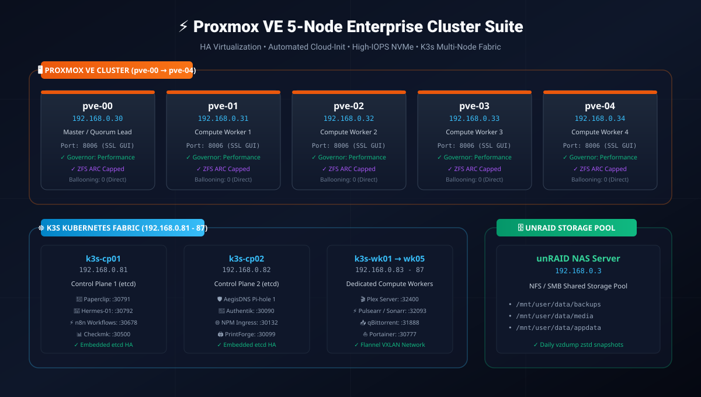

<div align="center">

# ⚡ Proxmox VE 5-Node Enterprise Cluster Suite

### High-Availability Proxmox Virtualization, Automated Cloud-Init Provisioning, Kernel Tuning & 6-Node K3s Cluster Fabric

<p align="center">
  
  
  
  
  
  
</p>

</div>

---

## 📸 Cluster Architecture & Network Topology



---

## 🖥️ Cluster Hardware & Hypervisor Map

| Node | IP Address | PVE Web GUI | Role | Specs & Tuning |
| :--- | :--- | :--- | :--- | :--- |
| **`pve-00`** | `192.168.0.30` | [https://192.168.0.30:8006](https://192.168.0.30:8006) | Master / Quorum Lead | Performance Gov • ZFS Capped • Balloon: 0 |
| **`pve-01`** | `192.168.0.31` | [https://192.168.0.31:8006](https://192.168.0.31:8006) | Compute Worker 1 | Performance Gov • ZFS Capped • Balloon: 0 |
| **`pve-02`** | `192.168.0.32` | [https://192.168.0.32:8006](https://192.168.0.32:8006) | Compute Worker 2 | Performance Gov • ZFS Capped • Balloon: 0 |
| **`pve-03`** | `192.168.0.33` | [https://192.168.0.33:8006](https://192.168.0.33:8006) | Compute Worker 3 | Performance Gov • ZFS Capped • Balloon: 0 |
| **`pve-04`** | `192.168.0.34` | [https://192.168.0.34:8006](https://192.168.0.34:8006) | Compute Worker 4 | Performance Gov • ZFS Capped • Balloon: 0 |
| **`unRAID`** | `192.168.0.3`  | [//192.168.0.3/data](file:///192.168.0.3/data) | Shared Storage NAS Pool | NFS Mounts: Backups, Media, AppData |

---

## 🚀 Key Orchestration Modules

### 1. Production Performance Tuning (`optimize_node.sh`)
- **No-Subscription Repositories**: Disables enterprise repos and enables `pve-no-subscription`.
- **Nag Popup Removal**: Patches `proxmoxlib.js` with permanent APT post-invoke hook.
- **CPU Governor**: Sets CPU governor to `performance` across all cores via persistent systemd service.
- **Kernel Sysctl**: `vm.swappiness = 10`, `vm.dirty_ratio = 10`, `net.ipv4.ip_forward = 1`.
- **ZFS ARC Cap**: Automatically caps ZFS ARC memory to 25% of node RAM.
- **Dedicated Memory**: Zero-ballooning optimization (`balloon: 0`) across all guest VMs for predictable bare-metal performance.

### 2. Shared Storage & Automated Backups (`setup_nfs_backups.sh`)
- Auto-registers NFS share from `192.168.0.3` (`/mnt/user/data/backups`) across the cluster.
- Configures automated daily `vzdump` snapshots with zstd compression at 3:00 AM.

### 3. K3s Kubernetes on LXC & VMs (`k3s_lxc_setup.sh`)
- Pre-provisions unprivileged nested LXC containers and cloud-init VMs.
- Configures cgroups v2, AppArmor delegation, and shared NFS volume mounts (`/data`).

### 4. Kubernetes HA Cluster & Workloads (`kubernetes/`)
Automated provisioning, storage, DNS, and orchestration scripts for the 6-node K3s cluster:
- `deploy_k8s_cluster.py`: Deploy 2 Control Planes & 4 Workers with embedded etcd HA.
- `deploy_portainer_k8s.py`: Deploy Portainer CE connected to in-cluster Kubernetes API.
- `configure_nfs_all_nodes.py`: Mount Unraid NFS storage (`/mnt/user/data`) across all nodes.
- `add_ssh_keys_to_cluster.py`: Inject SSH keys into root and plexadmin across nodes.
- `deploy_media_stack.py`: Deploy Sonarr, Radarr, and Prowlarr with persistent NFS storage.
- `deploy_plex.py`: Deploy Plex Media Server with persistent library mounts.
- `deploy_resume_cluster.py`: Deploy 4-replica zero-downtime resume website in namespace `web`.
- `sync_resume_cluster_via_pve.py`: Stream and sync web bundle to cluster shared storage via PVE gateway.
- `deploy_full_pihole_cluster.py`: Deploy 3-node Pi-hole v6 + Unbound + DoH cluster with Nebula-Sync.
- `sync_pve_hosts_to_pihole.py`: Sync all 140 hypervisor, VM, and LXC local DNS records to Pi-hole v6.
- `verify_pihole_cluster_dns.py`: Automated multi-node DNS resolution tester across cluster instances.
- `deploy_npm_cert_renewal.py`: Automated 10-day Let's Encrypt wildcard SSL renewal via Cloudflare DNS-01 and systemd timers.
- `expand_all_cluster_disks.py`: Live online disk expansion (+40GB) across all 6 nodes.
- `expand_all_cluster_ram.py`: RAM expansion (+2GB to 6GB) with hotplug support.
- `clean_and_test_keys.py`: Verify passwordless root SSH orchestration across the cluster.

### 5. Interactive 1-Click Orchestrator & Web Dashboard
- `orchestrator.py` & `run_suite.bat`: Multi-threaded Python dispatcher using Paramiko.
- `web_dashboard.py` on port 7880: Real-time status cards, live pinging, and 1-click web console launcher.

---

## 🛠️ Usage

### Run Orchestration Suite
```powershell
cd C:\scripts\proxmox_cluster_suite
.\run_suite.bat
```

### Launch Web Dashboard
```powershell
.\run_dashboard.bat
```
Navigate to **http://localhost:7880** for real-time node monitoring.

---

## 📄 License
MIT License. Created by ERTech Lab.
